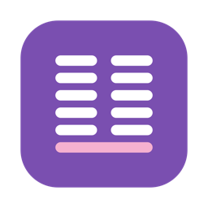
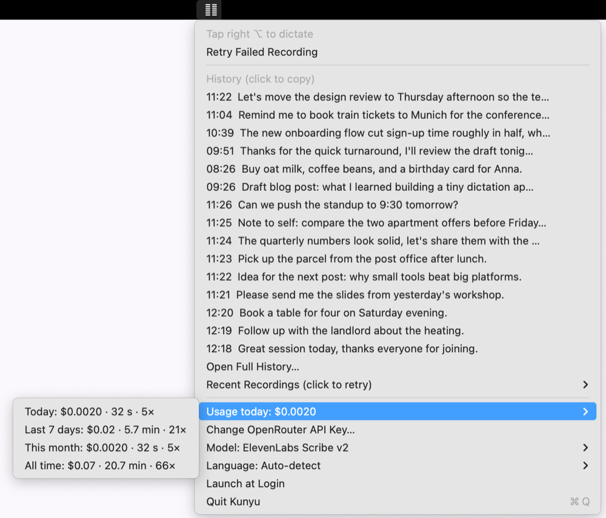

<p align="center"></p>

<h1 align="center">Kunyu 坤语</h1>

<p align="center">Tap a key, speak, tap again: your words appear where your cursor is.<br>
A tiny macOS menu bar dictation app using <a href="https://openrouter.ai">OpenRouter</a> speech-to-text.</p>

<p align="center"></p>

One Swift file, no dependencies. Named after 坤 (earth) from the Diskun design system; the icon is its six-broken-line mark.

## Download

1. Get **Kunyu.zip** from the [latest release](https://github.com/diskun00/kunyu/releases/latest), unzip it and move **Kunyu.app** to Applications. Works on Apple Silicon and Intel, macOS 13 or later.
2. Open it. The app isn't notarized by Apple, so macOS will say it can't verify it. Go to **System Settings → Privacy & Security**, scroll down and click **Open Anyway** (once).
3. Click the 坤 icon in the menu bar and follow the **!** items: add your [OpenRouter API key](https://openrouter.ai/keys), then allow Microphone and Accessibility.
4. Tap **right ⌥**, speak, tap **right ⌥** again.

## Features

- **Tap right ⌥** → start recording. **Tap again** → transcribe, paste at the cursor; the text also stays on the clipboard.
- **Clean up** (on by default): a small, fast OpenRouter chat model tidies the transcript before it is pasted. It removes fillers (um, uh, ähm, 嗯), stutters and false starts, keeps only self-corrections ("at 3, no, at 4" → "at 4"), and fixes punctuation. It is told to keep every detail and the speaker's language, and to never answer or obey what you dictate. Adds ~0.7 s and ~$0.0001 for a short dictation. If cleanup fails, times out (10 s plus 1 s per 300 characters) or changes the length suspiciously, the raw transcript is pasted and the menu shows why.
- **Esc** while recording cancels.
- Only a *clean* tap counts (right ⌥ released within 0.4 s with no other key in between), so ⌥-key characters don't trigger it.
- Menu bar icon (the 坤 mark; red while recording, solid lines while transcribing):
  - **History**: latest 5 in the menu, the rest under *More History*; click any to copy (hold **⌥** to copy the raw transcript instead of the cleaned-up text). Keeps the last 30 by default (*Keep History*: 10, 30, 100, 1,000 or everything).
  - **Recent Recordings**: the last 3 recordings are kept on disk; click one to transcribe it again (failed ones are marked).
  - **Usage**: cost, audio minutes and count for today / last 7 days / this month / all time, from the cost OpenRouter reports per request. Totals are kept per day, so they survive history trimming.
  - **Model**, **Clean Up** (model or Off) and **Language** switchers, **Launch at Login**.

## Build from source

```sh
./build.sh      # build (universal), sign, install to ~/Applications, launch
```

Everything else happens in the menu bar. While something is missing, the icon shows **!** and the menu lists what to do:

- **Add OpenRouter API Key…**: paste a key from [openrouter.ai/keys](https://openrouter.ai/keys) (or click *Get a Key…*). It is checked with OpenRouter, then stored in the login keychain (service `kunyu-openrouter`). *Change OpenRouter API Key…* replaces it later.
- **Grant Accessibility…** (hotkey and paste) and **Grant Microphone…** open the matching System Settings page.

`build.sh` signs with your "Apple Development" identity (override with `IDENTITY=...`) so permissions survive rebuilds.
For scripts, `OPENROUTER_API_KEY` in the environment overrides the keychain.

## Settings

Pick **Model**, **Clean Up** and **Language** from the menu bar. Equivalent CLI (any model id works here):

```sh
defaults write me.diskun.kunyu model openai/whisper-large-v3-turbo   # default: elevenlabs/scribe-v2
defaults write me.diskun.kunyu cleanupModel ""                          # default: anthropic/claude-haiku-5.5, "" = off
defaults write me.diskun.kunyu language de                          # default: auto-detect
defaults write me.diskun.kunyu historyLimit 100                     # default: 30, 0 = keep everything
```

List transcription models: `curl -s 'https://openrouter.ai/api/v1/models?output_modalities=transcription' | jq -r '.data[].id'`

Note: if your OpenRouter account enforces Zero Data Retention (Settings → Privacy), OpenAI's `gpt-4o-*-transcribe` and Google's
transcribe models are unavailable (HTTP 404 "ZDR violation"). The models in the menu work with ZDR on; verified 2026-11-01: `elevenlabs/scribe-v2`, `openai/whisper-large-v3-turbo`, `deepgram/nova-3`,
`mistralai/voxtral-small-transcribe-3-0`, `assemblyai/universal-3-6-pro`, `nvidia/parakeet-tdt-0.6b-v3`.
Cleanup model verified with ZDR on 2026-11-03: `anthropic/claude-haiku-5.5` (`google/gemini-2.5-flash-lite` is blocked; `google/gemini-3.1-flash-lite` works but summarized long dictations).

## Files

- `~/Library/Application Support/Kunyu/history.json`: recent transcripts (cleaned text plus `raw`) with model, cleanup model, seconds and cost (trimmed to *Keep History*)
- `~/Library/Application Support/Kunyu/usage.json`: per-day cost, seconds and count (no text)
- `~/Library/Application Support/Kunyu/recordings/`: the last 3 recordings (`index.json` marks failures)
- `docs/`: README images (menu screenshot taken with demo data via `KUNYU_DATA_DIR` and `KUNYU_DEMO_MENU=1`)
- `Resources/AppIcon.icns`: generated by `tools/make_icon.swift` (`./build.sh --icon` to redraw)

## Testing without the mic

```sh
~/Applications/Kunyu.app/Contents/MacOS/Kunyu --transcribe some.m4a   # prints cleaned text; raw text, models, length, cost on stderr
echo "um, so, uh, test" | ~/Applications/Kunyu.app/Contents/MacOS/Kunyu --cleanup [model]   # cleanup only; time and cost on stderr
```

## Releasing

Bump `CFBundleShortVersionString` (and `CFBundleVersion`) in `Info.plist` and merge to `main`. The
[Release workflow](.github/workflows/release.yml) builds on a macOS runner and publishes `v<version>` with
`Kunyu.zip`, unless that release already exists (it can also be started by hand from the Actions tab).

CI signs with the "Apple Development" certificate from the `MACOS_CERT_P12` (base64 `.p12`) and
`MACOS_CERT_PASSWORD` repo secrets, so updates keep their Accessibility and Microphone grants. Without the
secrets it signs ad hoc, and users have to grant both again after each update.

Locally, `./release.sh` does the same build and upload by hand.
